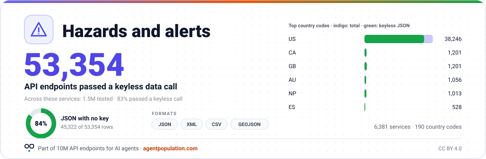
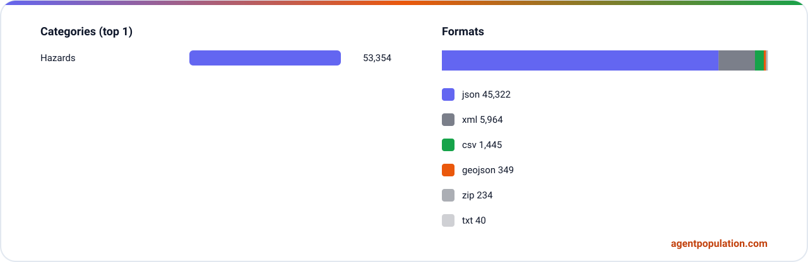

<p align="center"></p>

# ⚠️ Hazards and alerts API endpoints

**53,354 hazard and alert API endpoints that answered a keyless GET with a data body. For agent and app builders.**

<p align="center"><a href="#files"></a> <a href="#columns-and-tags"></a> <a href="#whats-inside"></a> <a href="#whats-inside"></a> <a href="LICENSE"></a></p>

<p align="center"><a href="#whats-in-it-for-you">What's in it</a> · <a href="#for-ai-agents">For AI agents</a> · <a href="#quick-start">Quick start</a> · <a href="#test-it-yourself">Test it yourself</a> · <a href="#files">Files</a> · <a href="#licence-and-credit">Licence</a> · <a href="#part-of-10m-api-endpoints-for-ai-agents">More packs</a></p>

This repository holds a 1,000-row sample and the services list; the full list of 53,354 endpoints is one download from the [latest release](https://github.com/agentpopulation/53k-hazards-apis-for-agents/releases/latest).

**Endpoints for building a hazard map or alert tool.** Flood, wildfire, landslide, volcano, tsunami and earthquake hazard map layers, most of them on ArcGIS Online, plus US county weather alerts (NWS), Japanese weather warnings (JMA) and US hazard and drought outlooks (NOAA), as URLs that answered with no key on their test date. The alert, warning and outlook rows are the smaller part; the App features bucket counts them.

Selection rule: rows where `category is "Hazards"`, less the rows that a leave-out rule drops (each counted under Known limits).

28,713 of these 53,354 rows match the focus rule (below); the others are in the pack by the selection rule only, and Known limits says what they are. 33,382 rows (62.6%) are map layers on ArcGIS Online, where anyone can publish.

## In plain words

**What is an API endpoint?** An API endpoint is one web address that a program can ask for data, for example the latest reading at one weather station. A single service, such as a national weather agency, can have thousands of endpoints: one per station, city or dataset. This pack counts endpoints, not separate services.

**What does "passed a data call" mean?** On the date shown in each row, AgentPopulation sent one plain request to that address, with no password or key, and got a non-empty data body back (JSON, CSV, XML or a file): not an error page and not an empty result. Some bodies describe a dataset rather than hold its values; see Known limits. It shows the address answered with data on that day. It is not a promise that it answers today, and licences and usage limits were not reviewed.

## What's in it for you

Four ways to use this pack. Each bucket gives a count, a filter you can apply to the CSV, one example that passed, and a list of recommended starting points with the rule that picked them. Buckets overlap; a row can fit more than one.

Examples, recommended lists and the preview are drawn from rows that match this pack's focus rule, so a row that the selection rule put in this pack but that is about something else is not shown as a starting point. Counts cover the whole bucket.

<details>
<summary>The focus rule</summary>

Focus rule: `title matches /hazard(?!ous)|alerts?\b|warnings?|\bwatch(es)?\b|advisor(y|ies)|outlook|emergency (alert|warning|management|operation|response|evacuation|shelter|plan|zone)|evacuat|shelters?\b|disaster|flood|inundat|wild ?fire|bush ?fire|forest ?fire|fire (danger|weather|perimet|risk|hazard)|burn(ed)? (area|scar|severity)|smoke|earthquake|quake|seism|sism|\bfaults?\b|liquefact|volcan|\blava|eruption|lahar|tsunami|landslide|mudslide|debris flow|rock ?fall|avalanche|subsiden|drought|hurricane|cyclone|typhoon|storm(?! ?water| ?drain| ?sewer)|tornado|sea level rise|erosion|heat ?wave|extreme heat|\bhail|blizzard|\brisk|rischio|pericol|frana|alluvion|hochwasser|überschwemm|erdbeben|waldbrand|lawine|naturgefahr|gefahrenkarte|incendi|inondation|riesgo|inundaci|σεισμ|deprem|terremot/i AND NOT title matches /waste|hazardous|chemicals|oil stocks|abfall/i AND NOT title matches /hospital|dialysis|medical|pharmac|homeless|address|\b(e|ng)?911\b|psap|food provider|school|fire ?stations?|hydrant|police|navigation hazard|bus ?shelter/i AND NOT title matches /missing person/i AND NOT url matches /request=getcapabilities|/csw/i AND NOT title matches /superseded/i AND NOT url matches //erddap/info/|@australiademo|risk_assessment_inputs/i AND NOT host in (sampleserver6.arcgisonline.com, test.maps.gov.bc.ca)`

</details>

### 🤖 Agent tools: Hazard zones, warnings and outlooks an agent can query

**25,041** endpoints from 4,103 services · Wrap one layer or warning feed as a get_hazard_at tool: pass a region code, or a point for a map layer, and return the hazard class, warning level or outlook category with a timeout. The tested layer queries return a few attribute rows and no geometry; set `returnGeometry=true` and add `geometry=lon,lat&geometryType=esriGeometryPoint&inSR=4326&spatialRel=esriSpatialRelIntersects` to ask about one place.

21,915 of these are map-layer queries that asked for a few records (`resultRecordCount`); raise it or page through for the whole layer.

Start with: `tags has agent-ready AND title matches /hazard(?!ous)|alerts?\b|warnings?|\bwatch(es)?\b|advisor(y|ies)|outlook|emergency (alert|warning|management|operation|response|evacuation|shelter|plan|zone)|evacuat|shelters?\b|disaster|flood|inundat|wild ?fire|bush ?fire|forest ?fire|fire (danger|weather|perimet|risk|hazard)|burn(ed)? (area|scar|severity)|smoke|earthquake|quake|seism|sism|\bfaults?\b|liquefact|volcan|\blava|eruption|lahar|tsunami|landslide|mudslide|debris flow|rock ?fall|avalanche|subsiden|drought|hurricane|cyclone|typhoon|storm(?! ?water| ?drain| ?sewer)|tornado|sea level rise|erosion|heat ?wave|extreme heat|\bhail|blizzard|\brisk|rischio|pericol|frana|alluvion|hochwasser|überschwemm|erdbeben|waldbrand|lawine|naturgefahr|gefahrenkarte|incendi|inondation|riesgo|inundaci|σεισμ|deprem|terremot/i`

Example: [Hazard - Earthquake - Live - Line - Nevada / Faul…](https://earthquake.usgs.gov/arcgis/rest/services/haz/Qfaults/MapServer/11/query?where=1%3D1&outFields=*&returnGeometry=false&resultRecordCount=5&f=json) · USGS Earthquake Hazards · passed 2026-11-15

<details>
<summary>Recommended starting points: 8 services, picked by the stated criteria inside</summary>

**Recommended starting points.** Selected by stated criteria, not a ranking of quality: Services in this pack with the most endpoints that match this bucket and are tagged `agent-ready` (no key sent in the test call, JSON body, passed a data call). Ties go to the service with more country codes, then by name. Only services with at least one bucket row that matches the focus rule are listed, and the sample comes from those rows; the counts cover the whole bucket. The sample URL is the first row by URL sort after preferring, in this order: rows that match the bucket's sample preference when it has one, rows that return values rather than describe a dataset or a service (not ERDDAP /info/ pages, OGC GetCapabilities requests, bare OWS addresses, PxWeb tables, UN SDG series lists, Statistics Canada download pointers, WorldPop listings, GTFS validation reports, untitled rows or service root addresses), and agent-ready rows. Sample preference in this bucket: `NOT url matches ///(services[0-9]*(-[a-z0-9]+)?|utility)\.arcgis\.com//i AND title matches /warning|outlook|hazard|flood/i`. Services named "ArcGIS organization" hold map layers from many owners and are added only when fewer than 5 other services match.

| Service (host) | Endpoints in bucket | In pack | Country codes in bucket | Formats in bucket | Sample URL that passed |
|---|---:|---:|---|---|---|
| USGS Earthquake Hazards (earthquake.usgs.gov) | 1,021 | 1,143 | 13 codes | json | [Hazard - Earthquake - Live - Line - Nev…](https://earthquake.usgs.gov/arcgis/rest/services/haz/Qfaults/MapServer/11/query?where=1%3D1&outFields=*&returnGeometry=false&resultRecordCount=5&f=json) (2026-11-15) |
| Bipadportal (bipadportal.gov.np) | 999 | 999 | NP | json | [BIPAD Portal (Nepal NDRRMA disaster inf…](https://bipadportal.gov.np/api/v1/district/1/) (2026-11-15) |
| Doi (doi.org) | 424 | 790 | global or unknown | json | [Projecting community changes in hazard …](https://doi.org/10.5066/F70G3HB8) (2026-11-15) |
| FEMA AGOL (ArcGIS Online) (services.arcgis.com) | 342 | 468 | GB, US | json | [FEMA National Risk Index by County](https://services.arcgis.com/XG15cJAlne2vxtgt/ArcGIS/rest/services/National_Risk_Index_Counties/FeatureServer/0/query?where=1%3D1&outFields=*&returnGeometry=false&resultRecordCount=5&f=json) (2026-11-14) |
| ArcGIS Online for Ontario Schools (ArcGIS Online) (services.arcgis.com) | 206 | 251 | 4 codes | json | [- Forest Fires 5okm](https://services.arcgis.com/QI0dObYawrKkuwDp/arcgis/rest/services/-%20Forest%20Fires%205okm/FeatureServer/0/query?where=1%3D1&outFields=*&returnGeometry=false&resultRecordCount=5&f=json) (2026-11-15) |
| California State University San Marcos GIS Lab (ArcGIS Online) (services.arcgis.com) | 161 | 196 | US | json | [Area within 15 Minutes Travel from Emer…](https://services.arcgis.com/uEH09Hfm70zI2ZxR/arcgis/rest/services/Area%20within%2015%20Minutes%20Travel%20from%20Emergency%20Shelters/FeatureServer/0/query?where=1%3D1&outFields=*&returnGeometry=false&resultRecordCount=5&f=json) (2026-11-15) |
| BrisMAP Public (ArcGIS Online) (services2.arcgis.com) | 153 | 173 | AU, US | json | [City Plan 2014 - Bushfire overlay](https://services2.arcgis.com/dEKgZETqwmDAh1rP/arcgis/rest/services/Bushfire_overlay/FeatureServer/0/query?where=1%3D1&outFields=*&returnGeometry=false&resultRecordCount=5&f=json) (2026-11-14) |
| Toronto District School Board (ArcGIS Online) (services2.arcgis.com) | 144 | 224 | CA, GB, US | json | [“Recent Earthquakes”](https://services2.arcgis.com/PuP9I73SXDqGc9Kp/arcgis/rest/services/%E2%80%9CRecent_Earthquakes%E2%80%9D/FeatureServer/0/query?where=1%3D1&outFields=*&returnGeometry=false&resultRecordCount=5&f=json) (2026-11-14) |

</details>

### 📱 App features: Weather alerts, warnings and hazard outlooks for an alert feed

**283** endpoints from 106 services · Show the alerts in force for a place: map the user's county or region to its zone code, fetch that alert or warning URL, and list event, severity and expiry time on a card or map.

58 of these are JMA warning files for one region of Japan.

Start with: `subcategory matches /^(Weather alerts by county|Weather warnings)$/i OR title matches /alerts?\b|warnings?|\bwatch(es)?\b|advisor(y|ies)|outlook/i`

Example: [JMA warnings: Soya](https://www.jma.go.jp/bosai/warning/data/warning/011000.json) · Jma · passed 2026-11-14

<details>
<summary>Recommended starting points: 8 services, picked by the stated criteria inside</summary>

**Recommended starting points.** Selected by stated criteria, not a ranking of quality: Services in this pack with the most endpoints that match this bucket and passed a data call. Ties go to the service with more country codes, then by name. Only services with at least one bucket row that matches the focus rule are listed, and the sample comes from those rows; the counts cover the whole bucket. The sample URL is the first row by URL sort after preferring, in this order: rows that match the bucket's sample preference when it has one, rows that return values rather than describe a dataset or a service (not ERDDAP /info/ pages, OGC GetCapabilities requests, bare OWS addresses, PxWeb tables, UN SDG series lists, Statistics Canada download pointers, WorldPop listings, GTFS validation reports, untitled rows or service root addresses), and agent-ready rows. Sample preference in this bucket: `subcategory matches /^(Weather alerts by county|Weather warnings)$/i`. Services named "ArcGIS organization" hold map layers from many owners and are added only when fewer than 5 other services match.

| Service (host) | Endpoints in bucket | In pack | Country codes in bucket | Formats in bucket | Sample URL that passed |
|---|---:|---:|---|---|---|
| Jma (www.jma.go.jp) | 58 | 58 | JP | json | [JMA warnings: Soya](https://www.jma.go.jp/bosai/warning/data/warning/011000.json) (2026-11-14) |
| NOAA GeoPlatform (ArcGIS Online) (services2.arcgis.com) | 25 | 105 | US | json | [2021 Spring Flood Outlook Polygons](https://services2.arcgis.com/C8EMgrsFcRFL6LrL/arcgis/rest/services/2021_Spring_Flood_Outlook_Polygons/FeatureServer/0/query?where=1%3D1&outFields=*&returnGeometry=false&resultRecordCount=5&f=json) (2026-11-14) |
| Usgs (data.usgs.gov) | 15 | 4,442 | US | xml | [Hurricane Michael Assessment of Potenti…](https://data.usgs.gov/datacatalog/metadata/USGS.00964f8d-39af-41cd-9b56-f93261f21456.xml) (2026-11-15) |
| Bund (warnung.bund.de) | 13 | 13 | DE | json, xml | [Bundesamt für Bevölkerungsschutz und Ka…](https://warnung.bund.de/api31/appdata/covid/covidinfos/DE/covidinfos.json) (2026-11-15) |
| Noaa (mapservices.weather.noaa.gov) | 10 | 30 | US | json | [Flood Hazards Outlook (FHO) - Experimen…](https://mapservices.weather.noaa.gov/experimental/rest/services/owp_fho/MapServer/0/query?where=1%3D1&outFields=*&returnGeometry=false&resultRecordCount=5&f=json) (2026-11-15) |
| Napsgfoundation (prep-response-portal.napsgfoundation.org) | 9 | 486 | global or unknown | csv, geojson, xml | [NOAA Tornado Warnings - CSV](https://prep-response-portal.napsgfoundation.org/api/download/v1/items/bba3d0a070d34cea9a303c24a71d5190/csv?layers=1) (2026-11-15) |
| Austintexas (data.austintexas.gov) | 6 | 74 | US | json, xml | [EMS - Quarterly Clinical Measures - Tra…](https://data.austintexas.gov/api/views/43eg-euh2/rows.json?accessType=DOWNLOAD) (2026-11-15) |
| mapping1.gw.govt.nz | 6 | 9 | NZ | json | [mapping1.gw.govt.nz: Floods/Flood\_Prote…](https://mapping1.gw.govt.nz/arcgis/rest/services/Floods/Flood_Protection_Advisory_Web_Map_2016/MapServer/10/query?where=1%3D1&outFields=*&resultRecordCount=10&f=json) (2026-11-15) |

</details>

### 🧠 Grounding and data pipelines: Flood, landslide, fire and seismic hazard zones for scheduled loads

**6,858** endpoints from 1,794 services · Load hazard zones on a schedule into your own store, so answers about the hazard at an address cite a dated source and a layer name.

Start with: `title matches /zones?\b|overlay|susceptib|risk|hazard (area|map)|floodplain|microzon|prone/i`

Example: [lanai\_vol - Volcanic and Seismic Hazard Intensity…](https://data.usgs.gov/datacatalog/metadata/USGS.00edba81-81a5-48da-bfb1-27b7eb506ac8.xml) · Usgs · passed 2026-11-15

<details>
<summary>Recommended starting points: 8 services, picked by the stated criteria inside</summary>

**Recommended starting points.** Selected by stated criteria, not a ranking of quality: Services in this pack with the most endpoints that match this bucket and passed a data call. Ties go to the service with more country codes, then by name. Only services with at least one bucket row that matches the focus rule are listed, and the sample comes from those rows; the counts cover the whole bucket. The sample URL is the first row by URL sort after preferring, in this order: rows that match the bucket's sample preference when it has one, rows that return values rather than describe a dataset or a service (not ERDDAP /info/ pages, OGC GetCapabilities requests, bare OWS addresses, PxWeb tables, UN SDG series lists, Statistics Canada download pointers, WorldPop listings, GTFS validation reports, untitled rows or service root addresses), and agent-ready rows. Sample preference in this bucket: `NOT url matches ///(services[0-9]*(-[a-z0-9]+)?|utility)\.arcgis\.com//i`. Services named "ArcGIS organization" hold map layers from many owners and are added only when fewer than 5 other services match.

| Service (host) | Endpoints in bucket | In pack | Country codes in bucket | Formats in bucket | Sample URL that passed |
|---|---:|---:|---|---|---|
| FEMA AGOL (ArcGIS Online) (services.arcgis.com) | 289 | 468 | GB, US | json | [FEMA National Risk Index by County](https://services.arcgis.com/XG15cJAlne2vxtgt/ArcGIS/rest/services/National_Risk_Index_Counties/FeatureServer/0/query?where=1%3D1&outFields=*&returnGeometry=false&resultRecordCount=5&f=json) (2026-11-14) |
| Usgs (data.usgs.gov) | 265 | 4,442 | US | xml | [lanai\_vol - Volcanic and Seismic Hazard…](https://data.usgs.gov/datacatalog/metadata/USGS.00edba81-81a5-48da-bfb1-27b7eb506ac8.xml) (2026-11-15) |
| Waterinfo (geoservice.waterinfo.be) | 182 | 188 | BE | xml | [Flood risk map Protected areas - FLUVIA…](https://geoservice.waterinfo.be/OGRK/download/FLU_hCC/beschermde_gebieden_FLU_hCC_T10.gml) (2026-11-14) |
| BrisMAP Public (ArcGIS Online) (services2.arcgis.com) | 160 | 173 | AU, US | json | [City Plan 2014 - Bushfire overlay](https://services2.arcgis.com/dEKgZETqwmDAh1rP/arcgis/rest/services/Bushfire_overlay/FeatureServer/0/query?where=1%3D1&outFields=*&returnGeometry=false&resultRecordCount=5&f=json) (2026-11-14) |
| University of Texas at Arlington (ArcGIS Online) (services5.arcgis.com) | 99 | 104 | US | json | [Enrich Landslide Risk Areas Landscape A…](https://services5.arcgis.com/z5pCt1Uf7GwSRRTu/arcgis/rest/services/Enrich%20Landslide%20Risk%20Areas%20Landscape%20Aaron/FeatureServer/0/query?where=1%3D1&outFields=*&returnGeometry=false&resultRecordCount=5&f=json) (2026-11-14) |
| Palomar College (ArcGIS Online) (services1.arcgis.com) | 88 | 111 | US | json | [Fire Hazard Severity Zones](https://services1.arcgis.com/rvD4Y1nm1VbVDxJv/arcgis/rest/services/Fire_Hazard_Severity_Zones/FeatureServer/0/query?where=1%3D1&outFields=*&returnGeometry=false&resultRecordCount=5&f=json) (2026-11-14) |
| ArcGIS Online: Local Overlays (data-1-hobartcc.opendata.arcgis.com) | 87 | 87 | AU | csv, xml, geojson, json | [State Overlays - Coastal Hazard Band Er…](https://data-1-hobartcc.opendata.arcgis.com/api/download/v1/items/d42f45dc18ce41199a48bfd73a20212a/geojson?layers=25) (2026-11-15) |
| University of South Florida GIS (ArcGIS Online) (services1.arcgis.com) | 75 | 101 | US | json | [Enriched Landslide Risk Areas (Annette …](https://services1.arcgis.com/sQOueNHZBxRJjRN3/arcgis/rest/services/Enriched%20Landslide%20Risk%20Areas%20%28Annette%20Leshko%29/FeatureServer/0/query?where=1%3D1&outFields=*&returnGeometry=false&resultRecordCount=5&f=json) (2026-11-15) |

</details>

### 🧪 Evals and testing: Alerts, hazard layers and files to test a hazard tool

**53,354** endpoints · 6,381 services · 190 country codes · 6 formats · Run your hazard tool against a fixed set of URLs across formats; check that event, hazard class or warning level parse, and keep last_tested as the baseline for your own re-tests.

Start with: the whole pack

Example: [M2.5 Recent Earthquakes](https://earthquake.usgs.gov/arcgis/rest/services/eq/Recent_Earthquakes/MapServer/0/query?where=1%3D1&outFields=*&returnGeometry=false&resultRecordCount=5&f=json) · USGS Earthquake Hazards · passed 2026-11-14

<details>
<summary>Recommended starting points: 8 services, picked by the stated criteria inside</summary>

**Recommended starting points.** Selected by stated criteria, not a ranking of quality: Services in this pack that returned the most different formats, then the most endpoints that passed a data call, then by name: a mix of response shapes to test parsers and tool calls. Only services with at least one bucket row that matches the focus rule are listed, and the sample comes from those rows; the counts cover the whole bucket. The sample URL is the first row by URL sort after preferring, in this order: rows that match the bucket's sample preference when it has one, rows that return values rather than describe a dataset or a service (not ERDDAP /info/ pages, OGC GetCapabilities requests, bare OWS addresses, PxWeb tables, UN SDG series lists, Statistics Canada download pointers, WorldPop listings, GTFS validation reports, untitled rows or service root addresses), and agent-ready rows. Services named "ArcGIS organization" hold map layers from many owners and are added only when fewer than 5 other services match.

| Service (host) | Endpoints in bucket | In pack | Country codes in bucket | Formats in bucket | Sample URL that passed |
|---|---:|---:|---|---|---|
| Napsgfoundation (prep-response-portal.napsgfoundation.org) | 486 | 486 | global or unknown | json, csv, xml, zip, geojson | [CA EVACUATIONS - KML](https://prep-response-portal.napsgfoundation.org/api/download/v1/items/15fb71971c7246338440d39b9f158bd7/kml?layers=0) (2026-11-15) |
| California Open Data Portal (gis.data.ca.gov) | 58 | 58 | US | json, csv, xml, geojson, zip | [Climate Vulnerability and Risk Assessme…](https://gis.data.ca.gov/api/download/v1/items/89decde0747b47aba61501ca4a57958c/geojson?layers=0) (2026-11-15) |
| ArcGIS Online: California Important Farmland (gis-cnra.hub.arcgis.com) | 40 | 40 | US | json, csv, xml, zip, geojson | [CGS Seismic Hazards Program: Landslide …](https://gis-cnra.hub.arcgis.com/api/download/v1/items/0860546963f147c78db3da52cd7ee413/geojson?layers=0) (2026-11-15) |
| California Natural Resources Agency Open (gis.data.cnra.ca.gov) | 37 | 37 | US | csv, json, zip, xml, geojson | [CGS Seismic Hazards Program: Landslide …](https://gis.data.cnra.ca.gov/api/download/v1/items/0860546963f147c78db3da52cd7ee413/geojson?layers=0) (2026-11-15) |
| Amerigeo (www.amerigeo.org) | 579 | 579 | global or unknown | xml, csv, json, geojson | [World Volcanoes - GeoJSON](https://www.amerigeo.org/api/download/v1/items/2a45f767a6e549bfbe5bf638681f1fac/geojson?layers=0) (2026-11-15) |
| ArcGIS Online: Local Overlays (data-1-hobartcc.opendata.arcgis.com) | 87 | 87 | AU | csv, xml, geojson, json | [State Overlays - Coastal Hazard Band Er…](https://data-1-hobartcc.opendata.arcgis.com/api/download/v1/items/d42f45dc18ce41199a48bfd73a20212a/geojson?layers=25) (2026-11-15) |
| Austintexas (data.austintexas.gov) | 74 | 74 | US | xml, json, csv, zip | [EMS - FY2017 Safety Report Risk Levels …](https://data.austintexas.gov/api/views/2ph5-gt5g/rows.json?accessType=DOWNLOAD) (2026-11-15) |
| NYC Open Data (Socrata) (data.cityofnewyork.us) | 41 | 41 | US | json, xml, csv, zip | [Citizen Emergency Response Team (CERT) …](https://data.cityofnewyork.us/api/views/b2gb-nkrq/rows.json?accessType=DOWNLOAD) (2026-11-15) |

</details>

The same lists are in [recommended.json](recommended.json), ready for an agent to load.

## Questions an agent can answer with this pack

- Which weather warnings does JMA list for a region of Japan? Try [JMA warnings: Soya](https://www.jma.go.jp/bosai/warning/data/warning/011000.json) (Jma, passed 2026-11-14).
- Which excessive-rainfall risk categories does NOAA's outlook list now? Try [Hazard - Flooding - Live - Polygon - Excessive Ra…](https://mapservices.weather.noaa.gov/vector/rest/services/hazards/wpc_precip_hazards/MapServer/2/query?where=1%3D1&outFields=*&returnGeometry=false&resultRecordCount=5&f=json) (Noaa, passed 2026-11-14).
- Which categories does the seasonal drought outlook carry, and for which target period? Try [Seasonal Drought Outlook](https://mapservices.weather.noaa.gov/vector/rest/services/outlooks/cpc_drought_outlk/MapServer/4/query?where=1%3D1&outFields=*&returnGeometry=false&resultRecordCount=5&f=json) (Noaa, passed 2026-11-14).

## What "passed a data call" means

> [!NOTE]
> On the date in `last_tested` (IST), one GET to the URL, sent with no key, returned HTTP 2xx and a non-empty data body. HTML pages and empty results did not pass. The `format` column records what came back. This is a test result for that date, not a promise that the URL answers today. Licences, terms, rate limits, accuracy and freshness were not reviewed. Endpoints are URLs, not separate APIs; many share one service. This pack was tested 14–15 Nov 2026; snapshot 15 Nov 2026.

## For AI agents

Start from keyless JSON endpoints (`agent-ready`). The code below loads `recommended.json` and calls the first recommended service in the Agent tools bucket, with a timeout (`node examples/agent-start.mjs --recommended`). With no argument, `node examples/agent-start.mjs` calls the most recently tested agent-ready row of the sample; pass a `.csv` or `.csv.gz` path to use that file instead. See [examples/agent-start.mjs](examples/agent-start.mjs).

```js
// Node 18+. Loads recommended.json (the local copy, or the raw file on GitHub) and calls one keyless JSON endpoint.
import fs from 'node:fs';

const RAW = 'https://raw.githubusercontent.com/agentpopulation/53k-hazards-apis-for-agents/main/recommended.json';
const rec = fs.existsSync('recommended.json')
  ? JSON.parse(fs.readFileSync('recommended.json', 'utf8'))
  : await (await fetch(RAW)).json();

const pick = rec.buckets.find((b) => b.id === 'agent').services[0];
try {
  const res = await fetch(pick.sample_url, {
    headers: { 'User-Agent': 'agent-example/1.0' },
    signal: AbortSignal.timeout(15000),
  });
  console.log(pick.service, res.status, res.headers.get('content-type'));
  console.log((await res.text()).slice(0, 300));
} catch (err) {
  console.log(`did not answer now; last passed ${pick.sample_last_tested} (${err.message})`);
}
```

How an agent picks an endpoint:

1. Filter to `agent-ready` and your country or topic.
2. Prefer the newest `last_tested` and the larger services.
3. Call with a timeout and check the body before you use it.

## Quick start

The examples run against the sample in `data/` out of the box (1,000 rows). Each takes an optional path to a `.csv` or `.csv.gz` file instead.

```bash
git clone https://github.com/agentpopulation/53k-hazards-apis-for-agents.git
cd 53k-hazards-apis-for-agents
python examples/quickstart.py
node examples/quickstart.mjs
node examples/agent-start.mjs
```

Full list: download `Hazards_API_Endpoints_AgentPopulation_Snapshot_2026-11-15.csv.gz` (53,354 rows, 2.6 MB) from [releases/latest](https://github.com/agentpopulation/53k-hazards-apis-for-agents/releases/latest), then gunzip it and pass its path. The scripts also read the `.csv.gz` as it is.

```bash
gunzip Hazards_API_Endpoints_AgentPopulation_Snapshot_2026-11-15.csv.gz
python examples/quickstart.py Hazards_API_Endpoints_AgentPopulation_Snapshot_2026-11-15.csv
node examples/quickstart.mjs Hazards_API_Endpoints_AgentPopulation_Snapshot_2026-11-15.csv
```

### curl

Quote the URL: some contain commas.

```bash
curl -sL "https://raw.githubusercontent.com/agentpopulation/53k-hazards-apis-for-agents/main/data/Hazards_API_Endpoints_AgentPopulation_Sample.csv" | head -n 4
curl -s --max-time 15 "https://earthquake.usgs.gov/arcgis/rest/services/haz/Qfaults/MapServer/11/query?where=1%3D1&outFields=*&returnGeometry=false&resultRecordCount=5&f=json" | head -c 600
```

### Python

Standard library only: [examples/quickstart.py](examples/quickstart.py) reads the sample, or the path you pass, keeps agent-ready rows and calls the most recently tested one.

<details>
<summary>The code</summary>

```python
# Python 3, standard library only. Run from a clone of this repository:
#   python examples/quickstart.py [path]
# With no path it reads the sample in data/. Pass the full list from the latest release (.csv or .csv.gz) instead.
# Keeps agent-ready rows and calls the most recently tested one.
import csv
import gzip
import os
import re
import sys
import urllib.request

HERE = os.path.dirname(os.path.abspath(__file__))
path = sys.argv[1] if len(sys.argv) > 1 else os.path.join(HERE, "..", "data", "Hazards_API_Endpoints_AgentPopulation_Sample.csv")
opener = gzip.open if path.endswith(".gz") else open
with opener(path, "rt", newline="", encoding="utf-8") as f:
    rows = list(csv.DictReader(f))

agent = [r for r in rows if "agent-ready" in r["tags"].split("|")]
# Newest test date first; URLs that describe a dataset or a service rather than return values go last.
DESCRIBES = re.compile(r"/erddap/info/|action-report\.json$|[?&]request=getcapabilities|/GeoArea/[^/?]+/List|getFullTableDownloadCSV|hub\.worldpop\.org", re.I)
agent.sort(key=lambda r: r["last_tested"], reverse=True)
agent.sort(key=lambda r: 1 if DESCRIBES.search(r["url"]) else 0)
print(len(rows), "rows,", len(agent), "agent-ready")
if not agent:
    sys.exit(0)

row = agent[0]
req = urllib.request.Request(row["url"], headers={"User-Agent": "agent-example/1.0"})
try:
    with urllib.request.urlopen(req, timeout=15) as res:
        body = res.read(1_000_000).decode("utf-8", "replace")
        print(res.status, res.headers.get("Content-Type"))
        print(body[:300])
except Exception as err:
    print(f"did not answer now; last passed {row['last_tested']} ({err})")
```

</details>

### JavaScript

Reads the sample as JSON because the CSV has quoted commas.

<details>
<summary>The code</summary>

```js
// Node 18+. Reads the sample as JSON (the CSV has quoted commas), local file first.
import fs from 'node:fs';

const FILE = 'data/Hazards_API_Endpoints_AgentPopulation_Sample.json';
const rows = fs.existsSync(FILE)
  ? JSON.parse(fs.readFileSync(FILE, 'utf8'))
  : await (await fetch('https://raw.githubusercontent.com/agentpopulation/53k-hazards-apis-for-agents/main/data/Hazards_API_Endpoints_AgentPopulation_Sample.json')).json();

const row = rows.find((r) => r.tags.includes('agent-ready'));
const res = await fetch(row.url, { headers: { 'User-Agent': 'agent-example/1.0' }, signal: AbortSignal.timeout(15000) });
console.log(res.status, (await res.text()).slice(0, 300));
```

</details>

### Agent tools

[examples/agent-tools.json](examples/agent-tools.json) holds two tool definitions in the shape most tool-calling APIs accept (name, description, JSON Schema); rename `parameters` if yours uses another key. [examples/quickstart.mjs](examples/quickstart.mjs) implements them:

- `find_endpoints` searches the agent-ready rows of the list by words, country code (their format is json). When you load the tools of more than one pack, prefix the names (for example `hazards_find_endpoints`) so they do not clash.
- `fetch_endpoint` calls one URL, **refuses any URL that is not in the list** and does not follow redirects. The allowlist is built from the CSV, so a URL injected into a prompt is refused.

The same two tools can sit behind an MCP server.

## Test it yourself

Re-test endpoints from the sample with the same rule: HTTP 2xx and a non-empty body that is not an HTML page. Node 18+, no packages.

```bash
node tools/test-endpoints.mjs
```

It tests the first 50 URLs and prints one line: tested, passed, did not pass. Options: a `.csv` or `.csv.gz` path (the full list from the release), `--limit 50`, `--timeout-ms 10000`, `--out results.csv`. The results file holds `url`, `status`, `passed`, `content_type`, `ms` and `checked_at`; a status of `timeout` or `error:<code>` means no HTTP answer came back. It is polite: GET only, no key sent, at most 4 requests in flight, one at a time per listed host, at least 1 second between requests to one listed host, and reading stops once 256 kB of a body is kept. Redirects are followed and may lead to another host. `results.csv` is in `.gitignore`.

## Preview

One row from each of the five largest services among rows that match the focus rule, services with rows that return values first.

| Title | Service | Country | Format | Tested | Link |
|---|---|---|---|---|---|
| Hurricane Laura Overwash Extents - Original Metadata | Usgs | US | xml | 2026-11-15 | [data.usgs.gov](https://data.usgs.gov/datacatalog/metadata/USGS.0027d998-6dac-49d0-a247-58eda7736cdf.xml) |
| M2.5 Recent Earthquakes | USGS Earthquake Hazards | US | json | 2026-11-14 | [earthquake.usgs.gov](https://earthquake.usgs.gov/arcgis/rest/services/eq/Recent_Earthquakes/MapServer/0/query?where=1%3D1&outFields=*&returnGeometry=false&resultRecordCount=5&f=json) |
| BIPAD Portal (Nepal NDRRMA disaster information): district … | Bipadportal | NP | json | 2026-11-15 | [bipadportal.gov.np](https://bipadportal.gov.np/api/v1/district/1/) |
| Monthly Streamflows, Drought Indices, and Supporting Statis… | Doi | global or unknown | json | 2026-11-15 | [doi.org](https://doi.org/10.5066/F70C4T19) |
| FEMA National Risk Index by County | FEMA AGOL (ArcGIS Online) | US | json | 2026-11-14 | [services.arcgis.com](https://services.arcgis.com/XG15cJAlne2vxtgt/ArcGIS/rest/services/National_Risk_Index_Counties/FeatureServer/0/query?where=1%3D1&outFields=*&returnGeometry=false&resultRecordCount=5&f=json) |

Browse the 1,000-row sample: [Sample CSV](data/Hazards_API_Endpoints_AgentPopulation_Sample.csv) · [Sample JSON](data/Hazards_API_Endpoints_AgentPopulation_Sample.json).

## What's inside

<p align="center"></p>

<details>
<summary>Country codes: 190</summary>

| Code | Country | Endpoints | |
|---|---|---:|---|
| US | United States | 38,246 | `████████████████████` |
| CA | Canada | 1,201 | `▋` |
| GB | United Kingdom | 1,201 | `▋` |
| AU | Australia | 1,056 | `▌` |
| NP | Nepal | 1,013 | `▌` |
| ES | Spain | 528 | `▎` |
| NZ | New Zealand | 488 | `▎` |
| IT | Italy | 359 | `▎` |
| DE | Germany | 349 | `▏` |
| CH | Switzerland | 263 | `▏` |
| | other 180 codes | 2,873 | |
| | global or unknown | 5,777 | `███` |

</details>

<details>
<summary>Categories: top 1</summary>

| Category | Endpoints | |
|---|---:|---|
| Hazards | 53,354 | `████████████████████` |

</details>

Formats: json 45,322 · xml 5,964 · csv 1,445 · geojson 349 · zip 234 · txt 40

<details>
<summary>Largest services: top 25 of 6,381</summary>

| Service | Host | Endpoints | Keyless JSON | |
|---|---|---:|---:|---|
| Usgs | data.usgs.gov | 4,442 | 0 | `████████████████████` |
| USGS Earthquake Hazards | earthquake.usgs.gov | 1,143 | 1,022 | `█████▏` |
| Bipadportal | bipadportal.gov.np | 999 | 999 | `████▌` |
| Nasa † | eonet.gsfc.nasa.gov | 998 | 998 | `████▌` |
| Doi | doi.org | 790 | 790 | `███▌` |
| Amerigeo | www.amerigeo.org | 579 | 187 | `██▋` |
| Napsgfoundation | prep-response-portal.napsgfoundation.org | 486 | 175 | `██▎` |
| FEMA AGOL (ArcGIS Online) | services.arcgis.com | 468 | 468 | `██▏` |
| ArcGIS Online layers (services5.arcgis.com, org W1uyphp8h2tna3qJ) | services5.arcgis.com | 408 | 408 | `█▉` |
| Heigit † | hot.storage.heigit.org | 393 | 0 | `█▊` |
| GIS Online at UCLA (ArcGIS Online) | services7.arcgis.com | 360 | 360 | `█▋` |
| ArcGIS Online layers (services6.arcgis.com, org tuxY7TQIaDhLWARO) | services6.arcgis.com | 284 | 284 | `█▎` |
| ArcGIS Online layers (services1.arcgis.com, org 0MSEUqKaxRlEPj5g) | services1.arcgis.com | 260 | 260 | `█▏` |
| ArcGIS Online for Ontario Schools (ArcGIS Online) | services.arcgis.com | 251 | 251 | `█▏` |
| ArcGIS Online layers (services4.arcgis.com, org 2hkgSaFLPcil5qfg) | services4.arcgis.com | 231 | 231 | `█` |
| ArcGIS Online layers (services5.arcgis.com, org vTs6mag4EJANhVTW) | services5.arcgis.com | 225 | 225 | `█` |
| Toronto District School Board (ArcGIS Online) | services2.arcgis.com | 224 | 224 | `█` |
| University of Minnesota (ArcGIS Online) | services.arcgis.com | 197 | 197 | `▉` |
| California State University San Marcos GIS Lab (ArcGIS Online) | services.arcgis.com | 196 | 196 | `▉` |
| Waterinfo | geoservice.waterinfo.be | 188 | 0 | `▉` |
| ArcGIS Online layers (services5.arcgis.com, org RbjlVNAtGGPx1hPV) | services5.arcgis.com | 173 | 173 | `▊` |
| BrisMAP Public (ArcGIS Online) | services2.arcgis.com | 173 | 173 | `▊` |
| Indiana University (ArcGIS Online) | services.arcgis.com | 172 | 172 | `▊` |
| National Interagency Fire Center (ArcGIS Online) | services3.arcgis.com | 160 | 160 | `▊` |
| U.S. Forest Service (ArcGIS Online) | services1.arcgis.com | 156 | 156 | `▊` |

† No row of these services matches the focus rule: the selection rule put them in this pack, so they are not used as a starting point.

</details>

<details>
<summary>Rows per test date: 14–15 Nov 2026</summary>

| Date (IST) | Endpoints | |
|---|---:|---|
| 2026-11-15 | 28,653 | `████████████████████` |
| 2026-11-14 | 24,701 | `█████████████████▎` |

</details>

## Files

| File | Rows | Size | Use |
|---|---:|---:|---|
| [data/Hazards_API_Services_AgentPopulation.csv](data/Hazards_API_Services_AgentPopulation.csv) | 6,381 | 392.3 kB | One row per service with its endpoint count in this pack |
| [data/Hazards_API_Endpoints_AgentPopulation_Sample.csv](data/Hazards_API_Endpoints_AgentPopulation_Sample.csv) | 1,000 | 332.0 kB | The sample: focus-rule rows first, each service in proportion to its share; ArcGIS Online layers count as one service |
| [data/Hazards_API_Endpoints_AgentPopulation_Sample.json](data/Hazards_API_Endpoints_AgentPopulation_Sample.json) | 1,000 | 529.8 kB | The same rows as JSON, tags as an array |
| [Hazards_API_Endpoints_AgentPopulation_Snapshot_2026-11-15.csv.gz](https://github.com/agentpopulation/53k-hazards-apis-for-agents/releases/latest) | 53,354 | 2.6 MB | The full list, gzipped CSV: a download from the latest release, checked by `SHA256SUMS.txt` |
| [tools/test-endpoints.mjs](tools/test-endpoints.mjs) | | | Re-tests endpoints from the sample or the full list |

Sample size: 1,000 rows, which is 1,000 or one third of the pack rounded down, whichever is smaller. Rows that match the focus rule come first. Each service gets rows in proportion to its share of those rows, at least one for the largest services and at most 50% of the sample while other services have rows; ArcGIS Online layers count as one service, whatever their organisation. Within a service, agent-ready rows, rows that return values and the newest test dates come first, and rows are written in turn across services. Service root addresses are placed at the end of the sample.

Full list: download `Hazards_API_Endpoints_AgentPopulation_Snapshot_2026-11-15.csv.gz` (53,354 rows, 2.6 MB) from [releases/latest](https://github.com/agentpopulation/53k-hazards-apis-for-agents/releases/latest), then gunzip it and pass its path. The scripts also read the `.csv.gz` as it is.

Excel users: Data > From Text/CSV, UTF-8. Files are UTF-8 without a byte-order mark and comma-separated.

## Columns and tags

<details>
<summary>Columns, types and tags</summary>

| Column | Type | Example | Meaning |
|---|---|---|---|
| url | string | [https://data.usgs.gov/datacatalog/metad…](https://data.usgs.gov/datacatalog/metadata/USGS.0027d998-6dac-49d0-a247-58eda7736cdf.xml) | The address that was tested |
| title | string | Hurricane Laura Overwash Extents - Orig… | Station, dataset or feed name |
| service | string | Usgs | The service the endpoint belongs to; joins to the services file together with host |
| host | string | data.usgs.gov | Host name of the address |
| country | string | US | ISO 3166-1 alpha-2 code, or EU; empty when global or unknown |
| category | string | Hazards | Category of the endpoint |
| subcategory | string |  | Left empty from the 15 Nov 2026 snapshot; kept so the columns stay the same |
| format | string | xml | What the test call returned: json, csv, geojson, xml, gtfs, zip, txt and so on |
| tags | string | `hazards\|open-data\|no-key\|xml` | Tags separated by \| |
| last_tested | date | 2026-11-15 | Date of the test call, YYYY-MM-DD (IST) |

| Tag | Rows | Meaning |
|---|---:|---|
| hazards | 53,354 | Topic tag |
| no-key | 53,354 | No key was sent in the test call |
| agent-ready | 45,322 | No key sent, JSON body, passed a data call on last_tested |
| json | 45,322 | Format of the body |
| maps | 41,318 | Topic tag |
| earthquakes | 10,315 | Topic tag |
| open-data | 9,284 | Topic tag |
| wildfire | 6,246 | Topic tag |
| xml | 5,964 | Format of the body |
| floods | 4,246 | Topic tag |
| volcanoes | 3,826 | Topic tag |
| weather | 1,473 | Topic tag |
| csv | 1,445 | Format of the body |
| government | 1,389 | Topic tag |
| tsunami | 1,357 | Topic tag |
| rivers | 1,073 | Topic tag |
| health | 867 | Topic tag |
| tides | 711 | Topic tag |
| statistics | 644 | Topic tag |
| oceans | 549 | Topic tag |
| climate | 538 | Topic tag |
| geojson | 349 | Format of the body |
| environment | 339 | Topic tag |
| elevation | 263 | Topic tag |
| transit | 257 | Topic tag |
| science | 213 | Topic tag |
| groundwater | 200 | Topic tag |
| finance | 126 | Topic tag |
| aviation | 116 | Topic tag |
| energy | 107 | Topic tag |
| economy | 98 | Topic tag |
| traffic | 83 | Topic tag |
| forecast | 60 | Topic tag |
| air-quality | 57 | Topic tag |
| parking | 39 | Topic tag |
| geocoding | 33 | Topic tag |
| ai-ml | 1 | Topic tag |
| bike-share | 1 | Topic tag |
| maritime | 1 | Topic tag |
| mcp-server | 1 | Topic tag |
| speech | 1 | Topic tag |

A machine-readable copy of this dictionary is in [datapackage.json](datapackage.json).

</details>

## Known limits

- 71.7% of rows carry country code US; 5,777 rows have no code (global or unknown).
- 1 rows come from PxWeb or Statistics Canada services. Some statistics endpoints return metadata or a pointer on GET; the table may need a second request or a POST.
- 22 rows are ERDDAP /info/ pages: they describe a dataset rather than return its values, so the series needs a second request.
- 39,924 rows are map-layer queries with resultRecordCount set: the tested call asked for a few records; change the query to get the full layer.
- 297 rows carry limit=1: the tested call asked for one record; raise the limit or page through.
- 8 rows are open-data portal dataset records, which may return a dataset record with links rather than the table itself.
- 274 rows are files (zip 234, txt 40) rather than bodies an agent reads directly.
- 33,382 rows are layers on ArcGIS Online, where anyone can publish: some are class projects, tests or copies. Check the owner and the fields before you rely on one.
- 346 rows are service descriptions (OGC GetCapabilities or catalogue records): they list layers or describe a dataset, so the features need a second request.
- 23,642 rows are in the Hazards category but have no hazard, warning or emergency term in the title. Check the title before you use one; they are not used as starting points.
- 562 rows are statistics on waste, chemicals or hazardous substances, not natural hazards or alerts.
- 1,921 rows are facilities, services or address layers (hospitals, medical services, schools, fire stations, 911 addresses, marine navigation hazards) filed with hazards, not natural-hazard data.
- 153 rows are layers marked superseded in their own title.
- 33 rows are evacuation-area snapshots with a date and time in the title; they show past areas, not current ones.
- 393 rows are country risk-assessment input tables (demographics, coping capacity, exposure), not hazard observations.
- 188 rows from New Zealand hosts (.nz) carry another country code or none in this snapshot; filter by host when you need New Zealand only.
- 145 rows from Canadian hosts (.ca) carry country code US in this snapshot; filter by host when you need Canada only.
- 222 rows are USGS or EMSC earthquake event queries with a fixed country box, minimum magnitude and start date; they return past events in that window until you change the query.
- Stations and feeds can go quiet after their test date; re-test a URL before you rely on it.
- Not in this pack: endpoints that need a key or a POST, and URLs that did not pass.
- Left out: 1,180 ArcGIS Survey123 layers (they can hold people's form answers).
- Left out: 982 class-exercise copies of the same few ArcGIS Online layers (Miami Beach sea level rise, high-risk areas without shelter, flooded areas, sea level rise and storm surge maps) across many organisations, many with a person's name in the title.
- Left out: 10 layers marked editable in the title (they can hold entries that people added).
- Left out: 155 ArcGIS layers that keep a form's default service name (they can hold people's form answers).
- Left out: 716 ArcGIS class or coursework layers (lab, assignment, exam, quiz, lesson, exercise, tutorial and final-project layers, copies of class layers, layers named for a person or a person's home, and layers whose name ends in a person's name or holds a student number).
- Left out: 79 ArcGIS layers that hold reports, comments, submissions or form responses sent in by the public.
- Left out: 140 class-exercise copies of the same few wildfire layers in one ArcGIS Online organisation, many with a person's name in the title.

## Licence and credit

> [!IMPORTANT]
> This list (URLs, titles, tags and test results) is © 2026 AgentPopulation, released under [CC BY 4.0](https://creativecommons.org/licenses/by/4.0/). Credit AgentPopulation and link agentpopulation.com. The data each endpoint returns belongs to its provider and stays under that provider's terms; this licence does not cover it.

Copy-ready credit:

`Hazards and alerts API endpoints by AgentPopulation (https://agentpopulation.com), CC BY 4.0, snapshot 15 Nov 2026.`

GitHub's "Cite this repository" button reads [CITATION.cff](CITATION.cff).

<!-- agentpopulation:start -->
## Part of 10M API endpoints for AI agents

This pack is one of the 24 topic packs of [10m-open-apis-for-ai-agents](https://github.com/agentpopulation/10m-open-apis-for-ai-agents), the open collection by [AgentPopulation](https://agentpopulation.com). Target: 10 million+ open API endpoints that pass a keyless API call.

AgentPopulation has tested over 5 million API endpoints: 5,129,834 tested, 3,726,509 passed a data call (snapshot 15 Nov 2026). This is the hazard and alert pack: 53,354 endpoints from 6,381 services. Packs overlap, so an endpoint can appear in more than one.

For the latest tested endpoints, search [agentpopulation.com/apis](https://agentpopulation.com/apis). This pack is a snapshot from 15 Nov 2026.

Sibling packs that share the most URLs with this one: [2.5m-agent-ready-apis](https://github.com/agentpopulation/2.5m-agent-ready-apis) (45,322 shared) · [10k-earthquake-apis-for-agents](https://github.com/agentpopulation/10k-earthquake-apis-for-agents) (10,315 shared) · [6.5k-wildfire-apis-for-agents](https://github.com/agentpopulation/6.5k-wildfire-apis-for-agents) (6,246 shared) · [270k-water-apis-for-agents](https://github.com/agentpopulation/270k-water-apis-for-agents) (6,148 shared) · [5.2k-volcano-tsunami-apis-for-agents](https://github.com/agentpopulation/5.2k-volcano-tsunami-apis-for-agents) (5,042 shared) · [190k-weather-apis-for-agents](https://github.com/agentpopulation/190k-weather-apis-for-agents) (1,549 shared). The rest are listed in [10m-open-apis-for-ai-agents](https://github.com/agentpopulation/10m-open-apis-for-ai-agents).

Questions, pack requests, reports of endpoints that stopped answering and requests to remove a row go to [Discussions](https://github.com/agentpopulation/10m-open-apis-for-ai-agents/discussions), or to [@agentpopulation](https://x.com/agentpopulation) on X. The packs are a work in progress and corrections are welcome.

Spotted a wrong row or a dead URL? Tell us on X: [@agentpopulation](https://x.com/agentpopulation).

If this pack saved you time, a star helps others find it.

---

Compiled by [AgentPopulation](https://agentpopulation.com) with [AP Desk](https://github.com/agentpopulation/apdesk) · [10m-open-apis-for-ai-agents](https://github.com/agentpopulation/10m-open-apis-for-ai-agents)

<!-- agentpopulation:end -->
